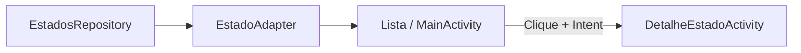

# Estados do Brasil

**Uma lista de estados com bandeiras e uma tela de detalhes para explorar RecyclerView e navegação no Android.**

Aplicativo acadêmico em Kotlin. Apresenta os 26 estados e o Distrito Federal a partir de um repositório em memória. Ao selecionar um item, abre uma tela com nome, bandeira, capital, população e região.

## O que o projeto demonstra

| Componente | Papel |
| --- | --- |
| `RecyclerView` | Exibição eficiente da lista vertical. |
| `EstadoAdapter` | Associação de cada objeto ao layout do item e ao evento de clique. |
| `Intent` | Passagem do estado selecionado para outra Activity. |
| `EstadosRepository` | Dados estáticos e referências dos recursos de bandeiras. |
| Layouts XML | Lista, item e detalhes com rolagem. |

Os valores populacionais fazem parte da base estática do exercício. Não são atualizados por uma API e não devem ser tratados como estatísticas atuais.

## Executar

Use Android Studio com JDK compatível com o Gradle do projeto e instale a plataforma **Android SDK 36** para compilar. O aplicativo declara **API mínima 24** para o dispositivo de execução; isso é diferente do SDK exigido no build.

```bash
git clone https://github.com/dlr-1337/EstadosBrasil-RecyclerView.git
cd EstadosBrasil-RecyclerView
```

Abra a pasta no Android Studio, sincronize o Gradle e execute em um emulador ou dispositivo compatível. Para gerar o APK debug no terminal:

```bash
sh gradlew assembleDebug
```

No Windows:

```powershell
.\gradlew.bat assembleDebug
```

A compilação usa o [catálogo de versões](gradle/libs.versions.toml) e a [configuração Android](app/build.gradle.kts). O alvo de bytecode Java/Kotlin declarado no módulo é 11; ele não deve ser confundido com o JDK necessário para executar o Gradle.

## Fluxo da aplicação



## Navegação pelo código

- [Código Kotlin](app/src/main/java/com/example/recyclerview/): Activities, adapter, modelo e repositório.
- [MainActivity.kt](app/src/main/java/com/example/recyclerview/MainActivity.kt): configuração da lista e abertura dos detalhes.
- [Layouts XML](app/src/main/res/layout/): apresentação da lista e dos detalhes.
- [Recursos visuais](app/src/main/res/drawable/): bandeiras e demais imagens.

Para alterar o conteúdo, edite `EstadosRepository.kt`. Para alterar o item visual, ajuste `item_estado.xml` e seu adapter. Busca e filtros estão fora do escopo descrito desta versão.

## Testes

```bash
sh gradlew test
sh gradlew connectedAndroidTest
```

O segundo comando exige um aparelho ou emulador. A documentação original identifica os testes presentes como os gerados pelo template; sua existência não comprova cobertura da navegação ou dos dados dos estados.

O projeto não depende de uma conta, banco remoto ou serviço de consulta geográfica para apresentar os dados locais.
